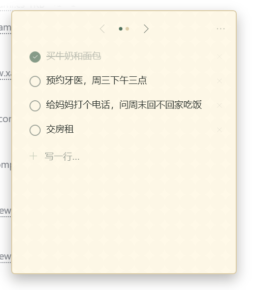
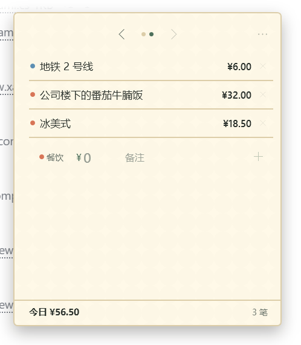
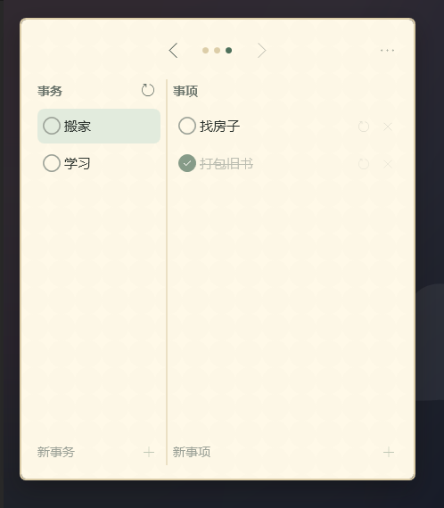
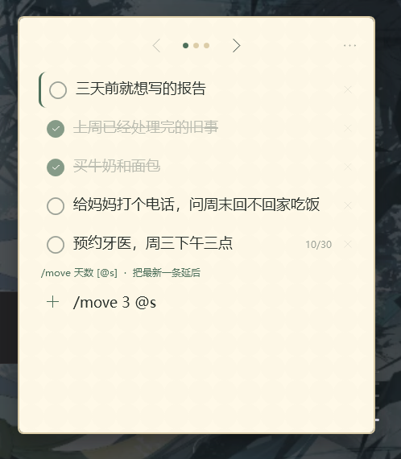
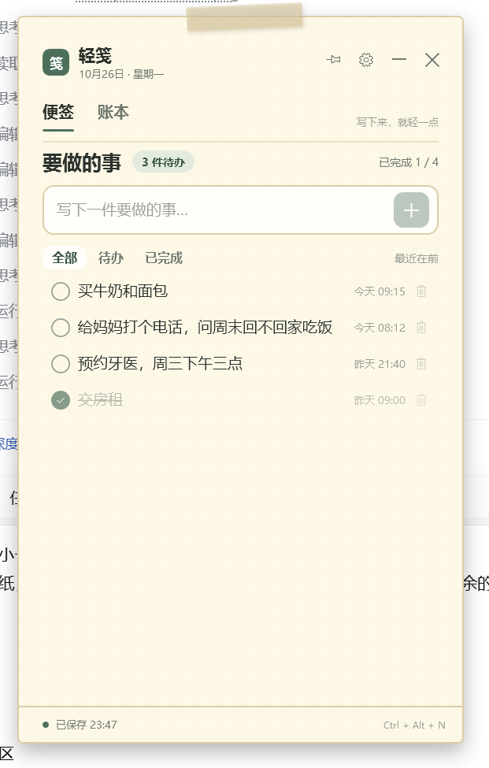
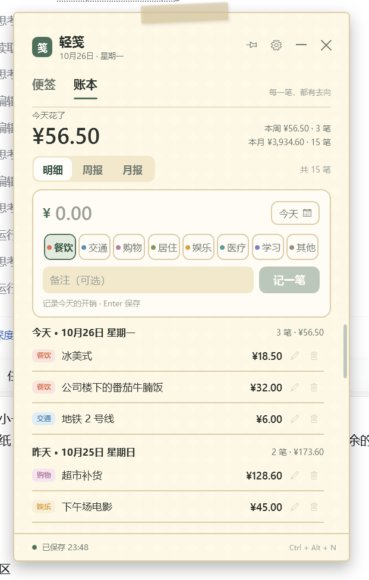
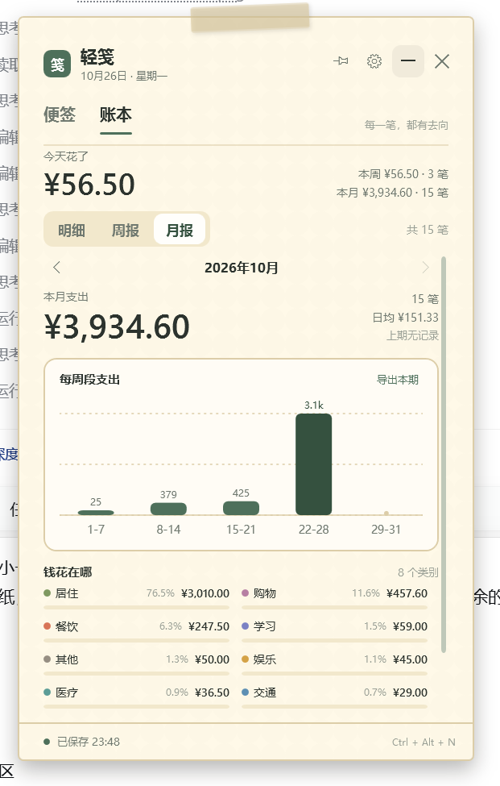

# 轻笺 · 便签、账本与计划

一张能钉在桌面上的小纸片：随手记待办，顺手记下今天的花销，也给长期的事情留一块地方。

原生 WPF / .NET 8 编写，无 Electron、无联网、无安装器。发布版只有一个约 **430 KB** 的 `DestNote.exe`，数据保存在本机并自动备份。







## 小卡片模式（默认）

一张纸，顶部 `‹  · · ·  ›` 翻三页：便签、账单、计划。没有标题、页签、筛选、页脚等多余文字。

### 第一页 · 便签
- 已有的条目从上往下排列
- 新内容直接写在最后一行，像在笔记本末尾加一行
- `Enter` 收好，新条目自然接在下面
- 点击圆圈完成；完成后**原地划掉**，不会跳到别处
- 悬停条目可看到删除按钮；删除后短时可撤销
- 支持斜杠指令（见下）

### 第二页 · 账单
- 只显示今天的条目：类别色点、内容、金额
- 最后一行直接输入金额和备注，点类别可切换类别
- 金额栏支持算式：输入 `12+8+3` 会实时显示合计，保存时按合计入账
- 支持 `+ - * /`、括号、小数、全角 `＋ × ÷`，也支持带 `¥` 或千分位逗号粘贴
- 悬停账单的铅笔，或双击整行，可以**直接修改备注**；回车或点勾保存，`Esc` 取消
- 底部固定统计当天：今日合计与笔数
- 补记历史日期、编辑金额/类别、分类汇总请进入完整模式

### 第三页 · 计划
- 左侧是事务列表，右侧是当前事务的事项列表
- 底部输入行可添加事务或事项；点击左侧事务切换事项
- 点击圆圈划去，再点一次恢复
- 事务列表右上角、事项行尾的轮换图标，可把一条重新开始一轮并移到列表末尾
- 事务和事项都长期保存，不随日期清空
- 右侧事项自动归属于当前选中的事务；没有事务时添加事项会自动建一个「日常」事务

卡片默认约 332 × 380，可拖动、可缩放，并记住上次尺寸。右上角 `⋯` 菜单可进入完整模式、钉在桌面、收进托盘或退出。

## 快捷指令

在便签页最后一行输入 `/` 即可。输入时会显示一条极简用法提示，`Tab` 补全指令，`Enter` 执行。



| 指令 | 作用 |
| --- | --- |
| `/move 3 @s` | 把最新一条未完成事项延后 3 天；条目右侧会显示日期，并排到列表的延后位置 |
| `/move 7` | `@s` 可省略 |
| `/collect` | 收集所有今天以前的未完成事项：移到列表顶部，左侧显示绿色细线 |
| `/collect 7` | 只收集最近 7 天内、今天以前的未完成事项 |
| `/done` | 完成最新一条未完成事项 |
| `/done @s` | 同上，`@s` 表示最新一条 |
| `/help` | 查看指令提示 |

指令只改变已有数据，不会把 `/...` 本身记成一条便签。

## 完整模式

在卡片菜单点击「完整模式」即可进入；在完整模式设置中打开「小卡片模式」可回来。







完整模式保留全部管理能力：

### 便签
- 全部 / 待办 / 已完成筛选
- 双击文字就地编辑
- 删除、清空支持短时「撤销」

### 账本
- 手动输入金额、类别、备注，默认记在今天
- 金额同样支持算式，输入过程中实时显示合计
- 类别：餐饮、交通、购物、居住、娱乐、医疗、学习、其他
- 点日期按钮可补记任意过去日期
- 双击账单或点铅笔编辑；删除后可撤销
- 今日、本周、本月合计实时更新

### 周报 / 月报
- 周从周一开始统计，月按自然月统计
- 上一期 / 下一期切换，可回看历史
- 合计、笔数、日均、较上期变化
- 每日 / 每周段柱状图、类别占比和金额
- 可把当前汇总周期导出为 CSV（Excel 可直接打开）

### 桌面体验
- 无边框纸片，任意拖动、缩放，记住位置和尺寸
- 「钉在桌面」始终置顶
- 四种纸张颜色：奶油、抹茶、樱粉、雾蓝
- **不显示任务栏按钮，也不占 Alt+Tab，只常驻系统托盘**
- 关闭、最小化或 `Alt+F4` 都会收进托盘，进程继续在后台运行
- 从托盘菜单退出；小卡片右上角 `⋯` 菜单同样可以收进托盘或退出
- 托盘双击打开；全局快捷键 `Ctrl + Alt + N` 随时呼出并写便签
- 可选开机静默启动
- 单实例运行，重复启动会唤回已在托盘的窗口

## 运行

双击 `dist/DestNote.exe`，或使用桌面上已创建的「轻笺」快捷方式。若之后移动了 exe，把快捷方式的目标重新指向它即可。

系统要求：Windows 10 / 11 x64，.NET 8 Desktop Runtime。当前电脑已安装；若换到其它电脑提示缺少运行时，安装
[Microsoft .NET Desktop Runtime 8](https://dotnet.microsoft.com/download/dotnet/8.0) 即可。

启动后不会出现在任务栏，只会进入系统托盘。若托盘图标被折叠，展开通知区域即可看到「轻笺」。

## 快捷键与操作

| 操作 | 作用 |
| --- | --- |
| `Ctrl + Alt + N` | 全局呼出轻笺，切到便签页并聚焦输入行 |
| `Enter` | 添加便签 / 保存账单 / 执行指令 |
| `Tab` | 在 `/` 指令输入中补全指令 |
| 顶部 `‹` `›` | 在便签、账单、计划三页之间切换 |
| `⋯` | 完整模式、钉住、收进托盘、退出 |
| 关闭 / 最小化 / `Alt+F4` | 收进托盘，程序继续后台运行 |
| 托盘菜单 → 退出 | 真正结束进程 |
| `Esc` | 关闭设置 / 取消账单备注编辑 |
| 双击便签文字 / 账单行 | 完整模式中就地编辑 |

## 数据在哪里

所有数据只保存在这台电脑：

```text
%APPDATA%\DestNote\
├── data.json                     当前数据
├── data.bak.json                 上一版自动备份
└── backups\
    └── data-YYYYMMDD.json        每日快照（保留最近 30 份）
```

- 每次修改后自动保存，写入采用临时文件替换，降低断电损坏风险
- 主文件损坏时会自动尝试读取 `data.bak.json`
- 完整模式设置中可打开数据文件夹、导出 JSON 备份、导出全部账单 CSV
- 计划、指令产生的延后/收集状态都在同一份数据里
- 数据不随 exe 移动而丢失；重装程序不会覆盖数据

## 源码与构建

```powershell
dotnet build
dotnet publish DestNote.csproj -c Release -r win-x64 --self-contained false -p:PublishSingleFile=true -o dist
```

项目结构：

```text
DestNote.csproj         WPF 项目
App.xaml / App.xaml.cs  启动、单实例、主题
MainWindow.xaml         纸片外框、大小卡片切换、设置、托盘
Views/CardView.xaml     小卡片：便签 / 今日账单 / 指令
Views/PlanPage.xaml     计划：事务与事项
Views/NotesView.xaml    完整模式的便签
Views/BillsView.xaml    完整模式的账本
Views/SummaryView.xaml  周报 / 月报
ExpressionEvaluator.cs  金额算式解析
Controls/BarChart.cs    轻量自绘柱状图
DataStore.cs            JSON 持久化、原子保存、每日备份、CSV 导出
Models.cs               数据模型与周/月统计
SelfTest.cs             无界面自测（--selftest）
```

开发自测：

```powershell
.\dist\DestNote.exe --selftest
# 结果写入 selftest.log
```

## 说明

- 账本按“支出”设计，不包含收入与多账户
- 小卡片账单页只处理今天；补记、编辑与周/月汇总在完整模式
- `/move` 不会隐藏事项：它会在右侧显示延后日期，并排到纸条末尾
- `/collect` 会把旧事项移到顶部并加一条绿色侧线，便于集中处理
- 汇总统计以本机日期为准
- 设置中的纸张颜色、置顶、窗口位置会随数据一起保存
- 界面截图使用演示数据，实际数据保存在上面的 AppData 目录中
